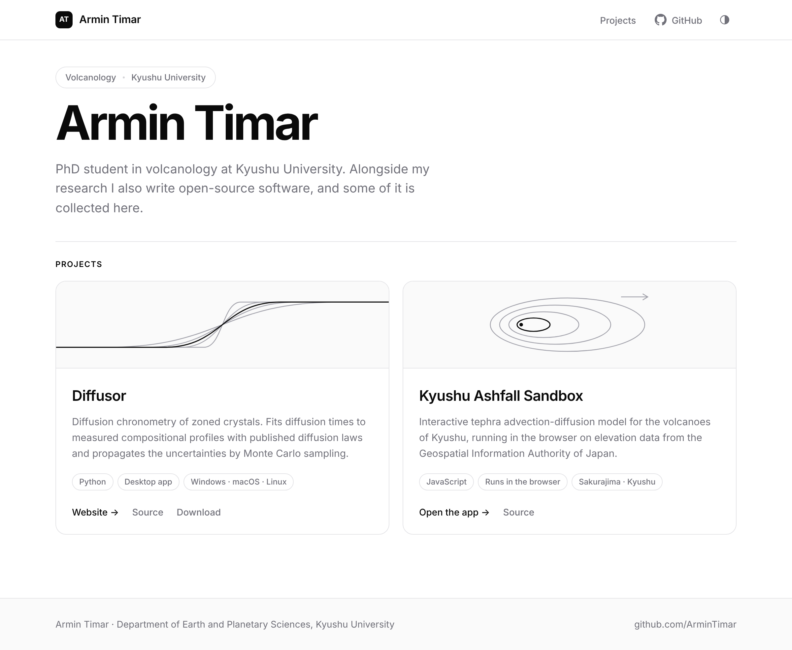

<div align="center">

# Armin Timar

Volcanology PhD student at Kyushu University, and the open-source software made alongside the research.

[armintimar.github.io](https://armintimar.github.io/) · [Diffusor](https://armintimar.github.io/Diffusor/) · [Kyushu Ashfall Sandbox](https://armintimar.github.io/ashfall-sandbox/)

<br>

<a href="https://armintimar.github.io/">
  <picture>
    <source media="(prefers-color-scheme: dark)" srcset=".github/screenshot-dark.png">
    
  </picture>
</a>

</div>

## Projects

| Project | What it does | Links |
| --- | --- | --- |
| Diffusor | Diffusion chronometry of zoned crystals. Fits diffusion times to measured compositional profiles with published diffusion laws and propagates the uncertainties by Monte Carlo sampling. Python desktop app for Windows, macOS and Linux. | [Website](https://armintimar.github.io/Diffusor/) · [Source](https://github.com/ArminTimar/Diffusor) · [Download](https://github.com/ArminTimar/Diffusor/releases/latest) |
| Kyushu Ashfall Sandbox | Interactive tephra advection-diffusion model for the volcanoes of Kyushu, running in the browser on elevation data from the Geospatial Information Authority of Japan. | [Open the app](https://armintimar.github.io/ashfall-sandbox/) · [Source](https://github.com/ArminTimar/ashfall-sandbox) |

Each project site is published from its own repository. This one holds only the landing page.

## How this site is built

A single static `index.html` with inline CSS and no build step. `.nojekyll` tells GitHub Pages to serve the files as they are. The page follows the system light or dark theme and remembers a manual choice in `localStorage`.

| File | Purpose |
| --- | --- |
| `index.html` | The landing page |
| `og-image.png` | 1280×640 preview image for link shares and the repository's social preview |
| `sitemap.xml` | Lists this page and the ashfall sandbox, which has no sitemap of its own |
| `robots.txt` | Points crawlers to this sitemap and Diffusor's |
| `.github/` | Screenshots used in this README |

To preview locally:

```bash
python3 -m http.server 8000
```

Then open <http://localhost:8000>.
